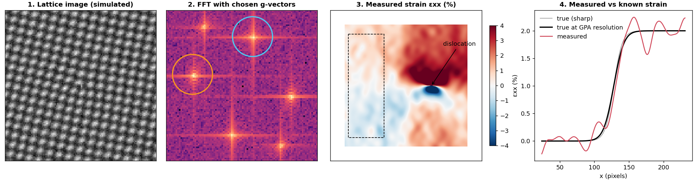

# StrainScope

[](https://github.com/CynthiaUkagha/strainscope/actions/workflows/tests.yml)

**Strain maps from atomic-resolution microscope images that check their own answers.**



Geometric phase analysis (GPA) turns a high-resolution TEM or STEM image into a map of lattice strain. It is used to measure strained silicon in transistors, interfaces in heterostructures and defects in catalysts and battery materials.

GPA has a catch. It always returns a strain map, even for an image with no lattice at all. StrainScope adds independent checks and grades every result **PASS**, **REVIEW** or **FAIL**, so a smooth-looking map is never mistaken for a correct one.

## What it checks

| Check | What it catches |
|---|---|
| Lattice peak strength | Images too noisy for the phase to mean anything |
| g-vector angle | Nearly parallel reflections that make the 2D strain tensor unstable |
| Mask size | Masks that overlap neighbouring peaks and mix their phases |
| Reference flatness | A "strain-free" reference region that is not actually flat. It compares the region's four quarters, so random noise averages out and a real gradient does not |
| Phase closure | A third reflection (g1 ± g2) that disagrees with the other two. This is an independent test the strain fit cannot pass by luck |
| Dislocation cores | Phase vortices where the map is no longer elastic strain |

## Results on images with known strain

Every test image is simulated from a known displacement field, so the right answer is known exactly.

| Input | Grade | Flagged by |
|---|---|---|
| Strained lattice, clean | **PASS** | all checks pass |
| Strained lattice + dislocation | **FAIL** | reference flatness, dislocation cores |
| Very noisy lattice | **FAIL** | lattice peak strength, reference flatness, phase closure |
| Pure noise (no lattice) | **FAIL** | lattice peak strength, reference flatness, phase closure, dislocation cores |

- **Accuracy:** without noise, the measured strain profile matches the known strain (at GPA's spatial resolution) to better than 0.01% strain.
- **Precision:** with realistic noise, row-averaged profiles stay within about 0.3% rms.
- **A bug the checks caught:** the phase-closure check first failed on a clean image. The cause was a real bug. It compared against g1+g2 when the second vector's sign meant the lattice actually had g1−g2. The tool now picks whichever reflection exists, and a regression test covers both signs.
- **A second fix, found by [ToolTrap](https://github.com/CynthiaUkagha/tooltrap):** the first flatness check used pixel scatter, so it rejected noisy images that were still measurable. Comparing quarter averages separates noise from a real gradient.

## Quick start

```bash
git clone https://github.com/CynthiaUkagha/strainscope.git
cd strainscope
pip install -e .
python examples/demo.py      # makes docs/overview.png and the grade table
pytest                       # 8 tests
```

```python
from strainscope import gpa, run_checks, report

res = gpa(image, reference=(slice(40, 216), slice(30, 90)))   # rows, cols of a strain-free area
grade, checks = run_checks(res)
print(report(grade, checks))
strain_xx = res.exx   # also res.eyy, res.exy, res.rotation
```

## How it works

1. Find the Bragg peaks in the FFT and choose two non-collinear reflections g1, g2.
2. Isolate each with a Gaussian mask and transform back to get a complex image whose phase is −2π g·u.
3. Refine g on the reference region, then turn the phase gradients into the displacement gradient tensor and the strain components.
4. Run the checks and grade the result.

Method: Hÿtch, Snoeck & Kilaas, *Ultramicroscopy* 74 (1998) 131–146.

## Limitations

- Tested on simulated images. Real images add specimen tilt, thickness and lens effects, so check results against a known standard first.
- Strain is relative to the reference region you choose.
- Spatial resolution is about 1/(2πσ) pixels, so features smaller than that are blurred.
- Check thresholds are sensible defaults, not calibrated values. Adjust them for your microscope.

## Author

**Onyinye Ukagha**, materials scientist working on electron microscopy, X-ray diffraction and self-checking scientific software.
[Website](https://cynthiaukagha.github.io) · [LinkedIn](https://www.linkedin.com/in/cynthiaukagha/)

MIT License
